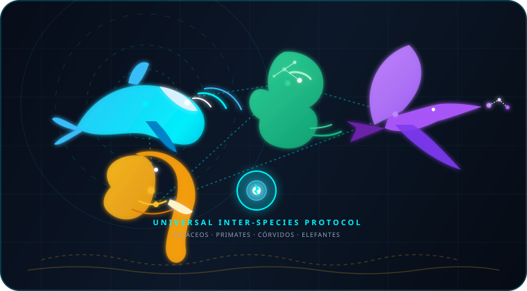

# ⚡ Frankenstein Lingua

**Plataforma de Decodificación Bioacústica y Comunicación Inter-Especies con IA**

[](https://www.python.org/downloads/)
[](https://streamlit.io)
[](LICENSE)
[](tests/)
[](data/patrones.json)
[](https://share.streamlit.io)

Un sistema de vanguardia inspirado en investigaciones como el **Project CETI** y publicaciones recientes en *Nature*, diseñado para decodificar, sintetizar y transpolar la comunicación de las especies con las capacidades cognitivas y comunicativas más cercanas al lenguaje: **Cetáceos, Primates no humanos, Córvidos/Psitácidos y Elefantes**.



---

## 🎯 Visión y Concepto

Durante milenios, la humanidad sólo ha dialogado consigo misma. Hoy, la convergencia entre **modelos de lenguaje (LLMs), bioacústica marina y terrestre y etología cognitiva** nos sitúa en la antesala de comprender los sistemas comunicativos de otras especies inteligentes.

**Frankenstein Lingua** actúa como un **Universal Bioacoustic Agent** que:
1. **Decodifica** señales complejas (silbidos firma, codas rítmicas con combinatoria fonémica, secuencias sintácticas de *pant-hoots*, alarmas semánticas y *rumbles* infrasónicos).
2. **Calcula métricas de teoría de la información** cuantitativas (Entropía de Shannon, frecuencia pico, complejidad sintáctica).
3. **Sintetiza audio bioacústico en tiempo real** en el navegador mediante la *Web Audio API*.
4. **Rompe el paradigma antropocéntrico con el "Router Inter-Especies"**: traduce mensajes directamente de **Animal A ➔ Animal B** transponiendo el contenido semántico universal al canal biofísico del receptor.
5. **Cose convergencias ("Modo Frankenstein")**: analiza cómo convergen los sistemas acústicos submarinos, sísmicos terrestres y aéreos.

---

## 🚀 Funcionalidades Principales

### 1. 🔬 Decodificación y Traducción Bioacústica
* Entrada de observaciones bioacústicas y conductuales.
* Soporte opcional para ingesta de datos tabulares / telemetría acústica en CSV.
* Identificación taxonómica y contraste contra 20 patrones bioacústicos curados.
* Estimación de confianza empírica (0-100%), evidencia científica y disclaimers éticos.

### 2. 🎛️ Consola Bioacústica Neural (Web Audio API)
* **Sintetizador Web Audio nativo** integrado en la interfaz de Streamlit (sin dependencias de backend pesadas como ffmpeg o librosa).
* Reproducción interactiva de:
  * **Cachalote:** Codas rítmicas de clics de cavidad nasal (*patrón 1+1+3*).
  * **Delfín:** Silbido firma con contorno de frecuencia modulada (*FM contour*).
  * **Elefante:** Zumbido sónico profundo simulando el rumble infrasónico de 20 Hz.
  * **Aves:** Ráfagas de notas sintácticas composicionales (*ABC-D*).
  * **Primates:** Secuencias rítmicas de *pant-hoots*.
* **Espectrograma Dinámico:** Envolvente espectro-temporal interactiva (Frecuencia vs. Tiempo vs. Intensidad).
* **Métricas de Teoría de la Información:**
  * **Entropía de Shannon ($H$):** Medida en bits/símbolo.
  * **Frecuencia Pico:** kHz o Hz dominantes.
  * **Índice de Complejidad Sintáctica.**

### 3. 🔀 Router Inter-Especies (Animal A ↔ Animal B)
* **Traducción directa sin intermediación humana:**
  * Selecciona especie emisora (ej. *Cachalote*) y especie receptora (ej. *Delfín* o *Elefante*).
  * Extracción de **invariantes semánticos universales**: Intención comunicativa, valencia afectiva y nivel de urgencia.
  * **Transposición de canal:** Adapta el mensaje al sistema nativo del receptor (ej. transpone una alerta de orcas de clics submarinos a un silbido firma ultrasónico en delfines o a un *rumble* sísmico podal en elefantes).
  * Cálculo de inteligibilidad teórica y escucha del audio adaptado.

### 4. ⚡ Modo Frankenstein (Fusión Multi-Especie)
* Combina simultáneamente señales de 2 a 4 especies distintas.
* Genera una síntesis inter-especie que identifica estructuras comunicativas compartidas.
* Permite adjuntar imágenes o espectrogramas para contrastar compatibilidad visual y morfológica mediante modelos multimodales.

### 5. 🌌 UI Bio-Cybernetic Lab (Dark Glassmorphism)
* Estética de laboratorio espacial con paleta de gradientes neón cian (`#00f2fe`), esmeralda y violeta.
* Tarjetas translúcidas con efecto *glassmorphism* (`backdrop-filter: blur(14px)`).
* Métricas numéricas con tipografía monoespaciada brillante (*JetBrains Mono*).

---

## 🧬 Especies y Base Científica

El sistema incluye 20 patrones bioacústicos curados basados en papers de referencia:

| Familia | Especie | Mecanismo Comunicativo | Evidencia Científica |
| :--- | :--- | :--- | :--- |
| **Cetáceos** | Delfín mular (*Tursiops truncatus*) | Silbido firma individual ("nombre propio") | Janik & Sayigh (2013); King & Janik (2013) |
| **Cetáceos** | Cachalote (*Physeter macrocephalus*) | Codas rítmicas de clics con combinatoria y tempo | Project CETI; Sharma et al. (*Nature Comms* 2024) |
| **Cetáceos** | Ballena jorobada (*Megaptera novaeangliae*) | Canto sintáctico jerárquico con evolución cultural | Payne & McVay (1971); Garland et al. (2011) |
| **Cetáceos** | Orca (*Orcinus orca*) | Dialectos vocales de clan matrilineal | Ford (1991); Foote et al. (2006) |
| **Primates** | Bonobo (*Pan paniscus*) | *Peep-calls* bivalentes y lexigramas simbólicos | Kanzi; Savage-Rumbaugh & Lewin (1994); Clay (2011) |
| **Primates** | Chimpancé (*Pan troglodytes*) | *Pant-hoots* ordenados y tamborileo sísmico | Girard-Buttoz et al. (*Comms Biology* 2022); Hobaiter (2014) |
| **Primates** | Mono Vervet (*Chlorocebus pygerythrus*) | Alarmas semánticamente discretas (leopardo/águila/serpiente) | Seyfarth, Cheney & Marler (1980) |
| **Córvidos** | Cuervo común (*Corvus corax*) | Deixis gestual con pico y modulación por afinidad | Pika & Bugnyar (2011); Boeckle et al. (2012) |
| **Psitácidos**| Loro gris (*Psittacus erithacus*) | Categorización referencial abstracta (color/forma/conteo) | Pepperberg (1999 - Alex Studies) |
| **Aves** | Carbonero japonés (*Parus minor*) | Sintaxis composicional en notas de alarma (*ABC-D*) | Suzuki, Wheatcroft & Griesser (*Nature Comms* 2016) |
| **Elefantes** | Elefante africano (*Loxodonta africana*) | *Rumbles* infrasónicos con etiquetas nominales individuales | Pardo et al. (*Nature Ecology & Evolution* 2024) |
| **Elefantes** | Elefante africano (*Loxodonta africana*) | Alarma específica para abejas y sismosonidos podales | King et al. (2010); O'Connell-Rodwell (2007) |

---

## 🏗️ Arquitectura del Sistema

```
frankenstein-lingua/
├── app.py                    # UI principal Streamlit con Glassmorphism y Consola Bioacústica
├── assets/
│   └── ecosistema.svg         # Ilustración vectorial futurista de los 4 linajes animales
├── agent/
│   ├── __init__.py
│   ├── frankenstein_agent.py # Motor orquestador: decodificación, LLM y Router Inter-Especies
│   ├── bioacoustics.py       # Sintetizador Web Audio, espectrogramas y métricas de Shannon
│   └── tools.py              # Herramientas determinísticas: buscar_patrones, evaluar_sensores
├── data/
│   ├── patrones.json         # Base curada de 20 patrones bioacústicos de alta fidelidad
│   └── sensores_ejemplo.csv  # Telemetría de ejemplo
├── tests/
│   ├── __init__.py
│   ├── test_tools.py         # Tests de herramientas bioacústicas
│   └── test_agent.py         # Tests de decodificación, Router y visión multimodal
├── requirements.txt
├── .env.example
└── README.md
```

### Flujo del Router Inter-Especies:

```
[ Señal Especie A ] ➔ [ Extracción Invariante Semántico ] ➔ [ Transposición Biofísica ] ➔ [ Canal Especie B ]
(ej. Coda Cachalote)   (Intención, Valencia, Urgencia)       (Mapeo de Frecuencia/Canal)    (Silbido Delfín / Rumble Elefante)
                                                                       │
                                                       [ Consola Web Audio API ]
                                                       (Síntesis Sonora en Tiempo Real)
```

---

## ⚙️ Instalación y Uso Local

### Requisitos Previos
* Python 3.11 o superior.
* Navegador moderno con soporte para Web Audio API (Chrome, Firefox, Safari, Edge).

### 1. Clonar el repositorio
```bash
git clone https://github.com/AngelTroncoso/Frankenstein-Lingua.git
cd Frankenstein-Lingua
```

### 2. Crear entorno virtual
```bash
python -m venv venv

# Windows
venv\Scripts\activate

# Linux / Mac
source venv/bin/activate
```

### 3. Instalar dependencias
```bash
pip install -r requirements.txt
```

### 4. Variables de entorno (Opcional para modo LLM)
```bash
cp .env.example .env
```
*Si no configuras ninguna API key, la aplicación corre de inmediato en **Modo Demo Científico**, utilizando los algoritmos bioacústicos y patrones determinísticos.*

Para habilitar razonamiento con LLM en tiempo real:
```env
LLM_PROVIDER=openai
OPENAI_API_KEY=tu-api-key-aqui
OPENAI_MODEL=gpt-4o-mini
```

### 5. Iniciar la aplicación
```bash
streamlit run app.py
```
Abre en tu navegador en `http://localhost:8501`.

---

## 🧪 Suite de Pruebas Automatizadas

El proyecto cuenta con **14 tests unitarios y de integración** pasando al 100%:

```bash
pytest -v
```

```
tests/test_agent.py::test_agent_inicializacion_demo PASSED             [  7%]
tests/test_agent.py::test_traducir_simple_demo PASSED                  [ 14%]
tests/test_agent.py::test_traducir_frankenstein_demo PASSED            [ 21%]
tests/test_agent.py::test_analisis_visual_requiere_proveedor_multimodal PASSED [ 28%]
tests/test_agent.py::test_imagenes_se_envian_asociadas_a_su_fuente PASSED [ 35%]
tests/test_agent.py::test_disclaimer_presente PASSED                   [ 42%]
tests/test_agent.py::test_confianza_rango_valido PASSED                [ 50%]
tests/test_agent.py::test_traducir_interespecies_demo PASSED           [ 57%]
tests/test_tools.py::test_cargar_patrones PASSED                       [ 64%]
tests/test_tools.py::test_buscar_patrones_por_especie PASSED           [ 71%]
tests/test_tools.py::test_buscar_patrones_por_tipo PASSED              [ 78%]
tests/test_tools.py::test_evaluar_sensores_csv_valido PASSED           [ 85%]
tests/test_tools.py::test_evaluar_sensores_csv_invalido PASSED         [ 92%]
tests/test_tools.py::test_buscar_patrones_sin_coincidencias PASSED     [100%]

============================= 14 passed in ~10s =============================
```

---

## 🎬 Guion de Demostración para Hackathons (90 Segundos)

* **0:00 - 0:20 | El Gancho:** Mostrar la interfaz bio-cibernética y contextualizar:
  > *"Presentamos Frankenstein Lingua: el primer agente bioacústico universal enfocado en decodificar las especies con proto-lenguaje y sintaxis (cetáceos, primates, córvidos y elefantes) inspirado en Project CETI."*
* **0:20 - 0:50 | Decodificación y Audio:** Ir a **"Traducción Bioacústica"**, seleccionar el ejemplo de **Cachalote** y presionar **"▶ Reproducir Frecuencia"**.
  > *"Aquí vemos la decodificación de una coda 1+1+3; el sistema no solo interpreta su significado, sino que calcula su Entropía de Shannon, muestra el espectrograma y sintetiza el audio acústico en tiempo real."*
* **0:50 - 1:20 | El Router Inter-Especies:** Cambiar a la pestaña **"Router Inter-Especies"**, seleccionar *Cachalote ➔ Delfín* y presionar **"⚡ Transpolar Protocolo Comunicativo"**.
  > *"Rompemos la barrera humano-animal: el Router extrae los invariantes semánticos universales (alerta por orcas) y los transpone a un silbido firma ultrasónico adaptado al canal auditivo del delfín."*
* **1:20 - 1:30 | Cierre:**
  > *"Una plataforma que combina IA de frontera y bioacústica para sentar las bases de la comunicación inter-especies y la conservación del planeta."*

---

## 🌐 Despliegue en Streamlit Community Cloud

1. Conecta tu repositorio de GitHub en [share.streamlit.io](https://share.streamlit.io).
2. Selecciona la rama `main` y el archivo principal `app.py`.
3. En **Settings → Secrets**, agrega tus credenciales si deseas usar OpenAI o Mistral:
   ```toml
   LLM_PROVIDER = "openai"
   OPENAI_API_KEY = "sk-..."
   OPENAI_MODEL = "gpt-4o-mini"
   ```
4. Despliega: el audio en tiempo real y el diseño visual funcionarán de forma nativa sin configurar servidores adicionales.

---

## 📄 Licencia y Consideraciones Éticas

* **Licencia:** MIT License.
* **Ética:** Este proyecto es un prototipo científico y educativo. Las interpretaciones bioacústicas se basan en investigaciones de literatura revisada por pares (*peer-reviewed*), pero no constituyen una traducción literal palabra por palabra del lenguaje subjetivo animal.

Desarrollado con ⚡ para la exploración del lenguaje universal de la vida.
